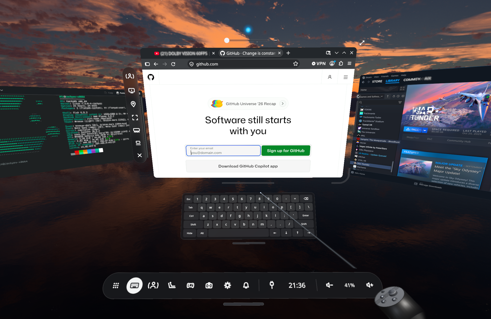

<!--
SPDX-FileCopyrightText: 2026 Aditya Mehra <aix.m@outlook.com>
SPDX-License-Identifier: CC-BY-4.0
-->

# Rift Home

Rift Home is a VR desktop for Linux on the Oculus Rift CV1. It is a Wayland compositor that runs on
[RiftLinux](https://github.com/AIIX/RiftLinux)'s OpenXR runtime and shows your apps as windows in a room around
you. You point at them with the Touch controllers, move them with your hands, and start new ones from a Home
launcher.



- Ordinary Linux apps (Wayland, and X11 through XWayland) as windows in the room, pointed at and clicked with the
  Touch controllers.
- Home: a launcher with a search field and a card for every running app.
- A dock with the keyboard, notifications, screenshots, volume, the time and the network.
- Windows you grab and move, make nearer or farther, scale, resize, tilt, curve, pin or let follow you.
- Cinema mode for video: one window as a large screen with the room dimmed.
- HDR video in Firefox and mpv, shown with its HDR description.
- Rooms around you: Rift Home's own, your own 2:1 panoramas and photos, or your desktop's wallpapers.
- A virtual keyboard that opens by itself under the window you type into.
- Notifications from your apps, shown in the room.
- Switching between Rift Home and other VR apps that use the same runtime.
- Steam and Proton games as windows, and game mode: the controllers become a gamepad for flat-screen games.
- Recline for bed or sofa: your windows turn to where you look, above you when you lie back.
- A Settings app for Wi-Fi and wired network, Bluetooth, sound, the time, the look of the room, the controller buttons
  (one button or two pressed together) and power, with a lens test to fit the headset.

## Requirements

- An Oculus Rift CV1 with its Touch controllers and sensors. Other headsets are not supported yet.
- [RiftLinux](https://github.com/AIIX/RiftLinux) 0.1.5 or later, installed and working.
- A 64-bit Linux computer. There are packages for Arch (and CachyOS, EndeavourOS, Manjaro), Fedora 44 and later and
  Ubuntu 26.10; other distributions build from source.
- An NVIDIA graphics card with driver 615 is the tested setup. AMD and Intel graphics are untested.

[Getting started](docs/getting-started.md) has the details.

## Install

Install RiftLinux first. Then download the package for your distribution from the
[releases page](https://github.com/AIIX/RiftHome/releases) and install it.

Arch, CachyOS, EndeavourOS and Manjaro:

```sh
sudo pacman -U rift-home-<version>-1-x86_64.pkg.tar.zst
```

Fedora 44 and later:

```sh
sudo dnf install ./rift-home-<version>-1.fc44.x86_64.rpm
```

Ubuntu 26.10:

```sh
sudo apt install ./rift-home_<version>-1_amd64.deb
```

### From source

You need a C++20 compiler, CMake 3.25 or later, Ninja and the following development packages:

- Qt 6.11 or later: Core, Gui, DBus and Test, plus Quick, QuickControls2 and Network for the Settings app
- wlroots 0.20
- wayland-server and wayland-client
- wayland-protocols 1.49 or later
- xkbcommon
- libdrm
- pixman
- OpenXR (the loader and headers)
- Vulkan (the loader and headers) and `glslc` (shaderc), for the shaders
- polkit's agent library (polkit-agent-1), for the password prompt in Settings
- xcb, for one of the test tools (optional)
- Doxygen, for the API documentation (optional)

```sh
cmake -S . -B build -G Ninja -DCMAKE_BUILD_TYPE=RelWithDebInfo
ninja -C build
ctest --test-dir build
```

Then install it as the package does (the programs, the login screen's session, the menu entry, the controller
models and rooms):

```sh
cmake -S . -B build -G Ninja -DCMAKE_BUILD_TYPE=RelWithDebInfo -DCMAKE_INSTALL_PREFIX=/usr
sudo cmake --install build
```

Use the `/usr` prefix: login screens look for sessions in `/usr/share/wayland-sessions`.

## First start

Log out and choose "Rift Home" on the login screen, or start "Rift Home" from your desktop's app menu. Put the
headset on. [Getting started](docs/getting-started.md) walks through the first minutes.

## Documentation

- [Documentation index](docs/README.md)
- [Getting started](docs/getting-started.md)
- [Using Rift Home](docs/using-rift-home.md)
- [Controllers](docs/controllers.md)
- [Settings](docs/settings.md)
- [Apps](docs/apps.md)
- [Troubleshooting](docs/troubleshooting.md)
- [Known limitations](docs/known-limitations.md)

## Getting help

Open an issue at [github.com/AIIX/RiftHome/issues](https://github.com/AIIX/RiftHome/issues). Say what you did, what
you expected and what happened, and attach the newest log from `~/.local/state/rift-home/logs/`. For problems with
the headset itself (no picture, tracking, controllers not found) look at RiftLinux's documentation first.
[Troubleshooting](docs/troubleshooting.md) says what to include.

## Licence

The code is licensed under the Apache License 2.0. The documentation and artwork (the controller models and the icon)
are licensed under Creative Commons Attribution 4.0 International. The files in `third_party/` are licensed under the
Boost Software License 1.0. See [LICENSE](LICENSE), [NOTICE](NOTICE) and the texts in [LICENSES/](LICENSES/).
