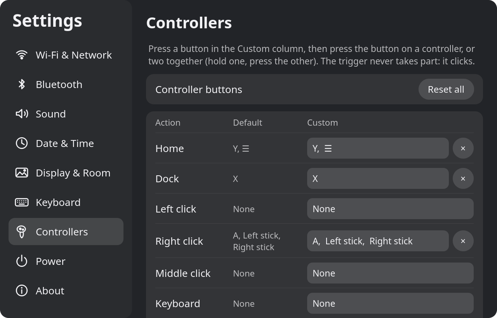

<!--
SPDX-FileCopyrightText: 2026 Aditya Mehra <aix.m@outlook.com>
SPDX-License-Identifier: CC-BY-4.0
-->

# Controllers

Rift Home is made for the Oculus Rift CV1's Touch controllers. This page says what each control does and how to
change the buttons.

## What the controls do

The trigger and the grip always do the same thing and cannot be changed. The other buttons have defaults that you can
change in Settings.

| Control | Left or right | What it does |
| --- | --- | --- |
| Trigger | both | Click. Starts an app in Home, presses a dock button or a key, and clicks in a window. Held on a window's grab bar, scale handle, tilt bar or curve slider, it drags that control. |
| Grip | both | Grab. Hold it on a window to move the window. Hold it on the keyboard or the dock to move them. |
| Thumbstick, pushed | both | Scroll in the window you point at. In Home, left and right turn the pages. While you hold a window with the grip, forward and back move it farther and nearer, and left and right make it smaller and larger. |
| Thumbstick, pressed | both | Right click by default. |
| X | left | Shows and hides the dock. |
| Y | left | Opens and closes Home. |
| Menu button | left | Opens and closes Home. |
| A | right | Right click. |
| B | right | Nothing by default. |
| Oculus button | right | The headset's own menu, from RiftLinux. Rift Home does not use it. |
| Grip held, then B | either grip | Recline: everything turns to where you look (lying back, on your side); again for upright. See [Lying back](using-rift-home.md#lying-back-recline). |

The ray belongs to the controller you used last: pull a trigger or squeeze a grip and that hand points. Moving a
controller or pressing a button brings back a pointer that has hidden, and the controller with it (see "Hide when
still" in [Settings](settings.md)).

A button set to Left click, Right click or Middle click stays pressed for as long as you hold it, so you can drag
with it.

## Change a button

Open Settings (the dock's Settings button, or the first icon in Home) and choose **Controllers**. The page has a row
for each thing a button can do, and for each row its default and your own buttons:

| Action | What it does |
| --- | --- |
| Home | Opens or closes Home. |
| Dock | Shows or hides the dock. |
| Left click | Acts as the trigger: a click on a window, a press on the dock, Home or the keyboard. Held, it stays pressed. |
| Right click | The right mouse button on the window you point at. Held, it stays pressed. |
| Middle click | The middle mouse button on the window you point at. Held, it stays pressed. |
| Keyboard | Shows or hides the virtual keyboard. |
| Screenshot | Saves one picture of your view in `~/Pictures/RiftHome/screenshots`. |
| Recline | Turns everything to where you look, or upright again. |
| Follow all, Game mode, Settings, Notifications | The dock's buttons of those names. |
| Volume up, Volume down, Mute | The dock's volume buttons. |

The defaults are: Home is Y and the menu button. Dock is X. Right click is A and both thumbstick presses. Recline is
a grip held and B. Everything else has no button until you give it one.

To set a button, press the row's button in the Custom column. It says "Press a button, or two together": press the
button on a controller, or hold one and press another, then let go. A button belongs to one action, so giving it to a
second action moves it (Settings says from where). **x** clears a row, **Reset** returns it to its default and **Reset
all** returns every row.

### Which buttons

| Name in Settings | Button |
| --- | --- |
| X, Y | The left controller's face buttons. |
| ☰ | The left menu button. |
| Left stick, Right stick | The thumbsticks, pressed. |
| A, B | The right controller's face buttons. |
| Left grip, Right grip | The grips, only together with another button: alone they grab. |

The triggers are not used: they click, and they are how you use Settings.

### Two buttons together

A binding can be two buttons, such as **Left grip + B**: hold one and press the other. Two buttons work in either
order; with a grip, hold the grip first (a grip squeezed while you hold a button, to grab something, leaves that
button as it is). That press of the second button does nothing else, and neither does letting go of the first. Any
two of the buttons above work.

A button that is also part of a pair of two buttons (not a grip) acts when you let go of it, and only if you did not
use it in the pair meanwhile. So X can be Dock and X with A can be Keyboard: a tap on X shows the dock, and X held
with a press of A opens the keyboard. A button that is not part of any pair acts as soon as you press it. The clicks
(Left, Right and Middle) stay pressed for as long as the button is held, and a pair for as long as both are held.

Home is always reachable. If nothing opens Home or the dock, the left menu button opens Home anyway, so you can
always get back to Settings.

A thumbstick press that comes right after you scrolled with it does not count as a click, so a push that ends in a
press does not click by accident.

### Settings from an earlier version

A settings file that has one action for each button (the older format) is read as before and saved in the new
format the next time you change a button. A button you had set to a click keeps working, and the grip and B
recline stays.

## Game mode

Game mode turns the controllers into a gamepad for a flat-screen game. Start it from the dock's game controller
button. The rays and the other buttons are off while it runs, and the controllers feel a firm tap. You need access
to `/dev/uinput`, which Steam's udev rules give to the user logged in at the computer.

| Controller control | Gamepad control |
| --- | --- |
| Left thumbstick | Left stick |
| Right thumbstick | Right stick |
| Left trigger | Left trigger |
| Right trigger | Right trigger |
| Left grip | Left bumper (LB) |
| Right grip | Right bumper (RB) |
| X | X |
| Y | Y |
| A | A |
| B | B |
| Left thumbstick pressed | Left stick pressed |
| Right thumbstick pressed | Right stick pressed |
| Left menu button, tapped | Start |

To leave game mode, hold the left menu button for one second. A message in front of you says "Keep holding" after
a moment. The gamepad stays connected after game mode ends, so a game keeps it and works again the next time you
turn game mode on. Outside game mode it presses nothing, so other programs never get presses from it. It goes away
when Rift Home quits.
