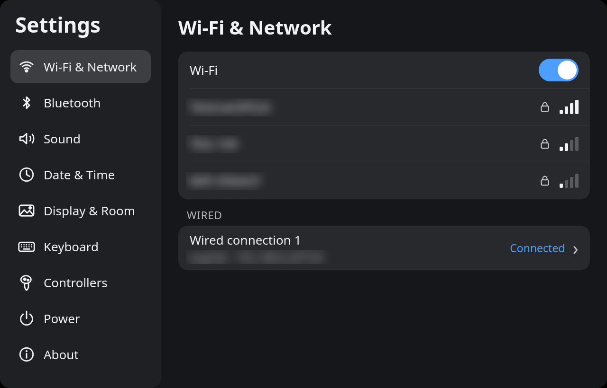
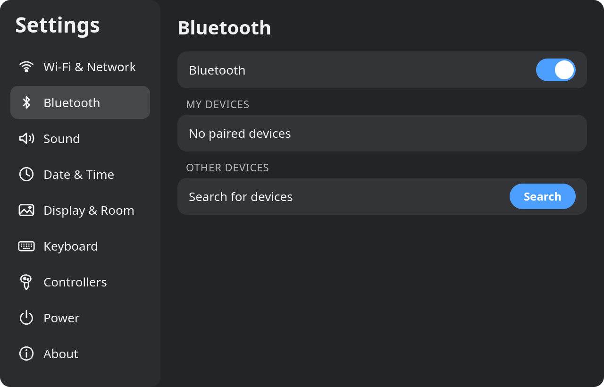
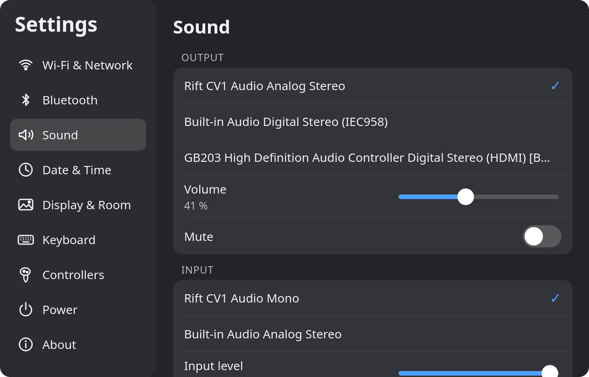
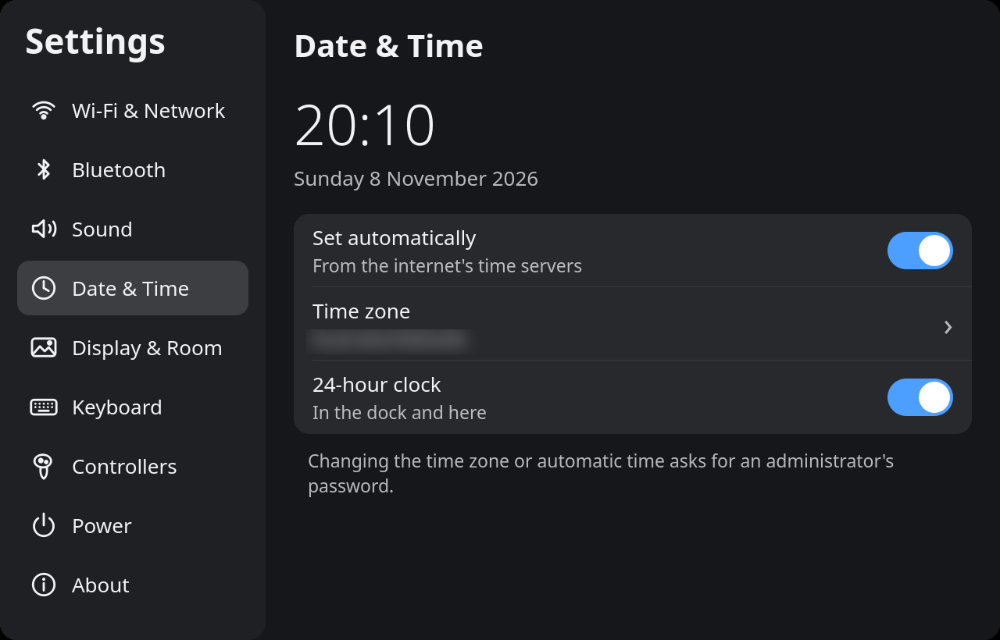
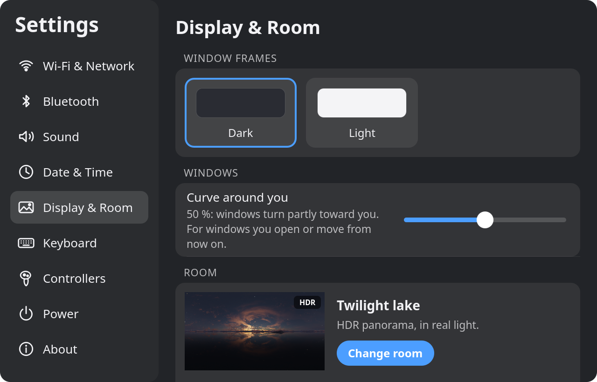
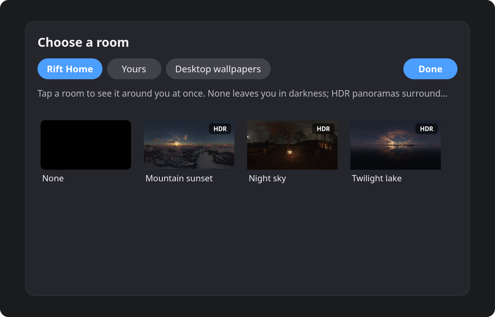
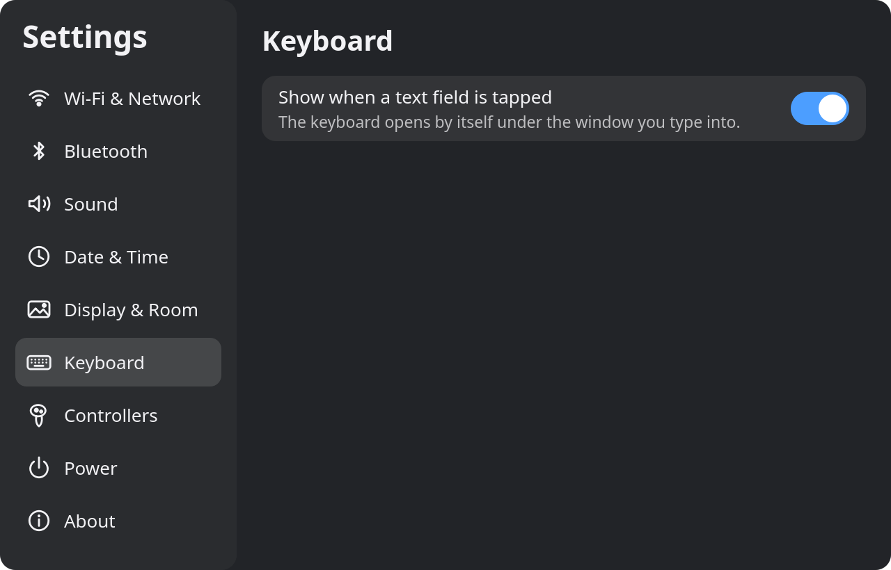
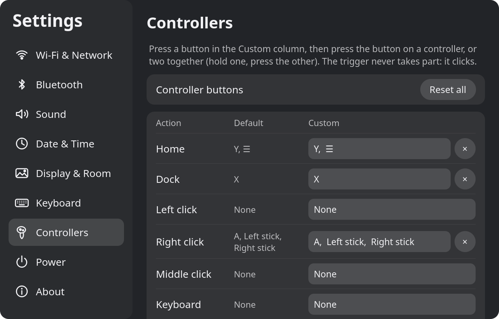
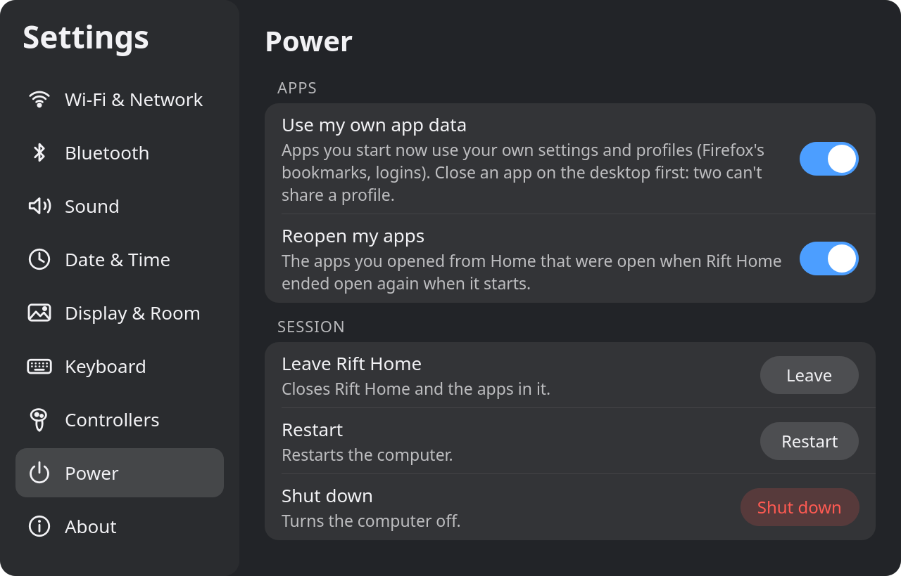
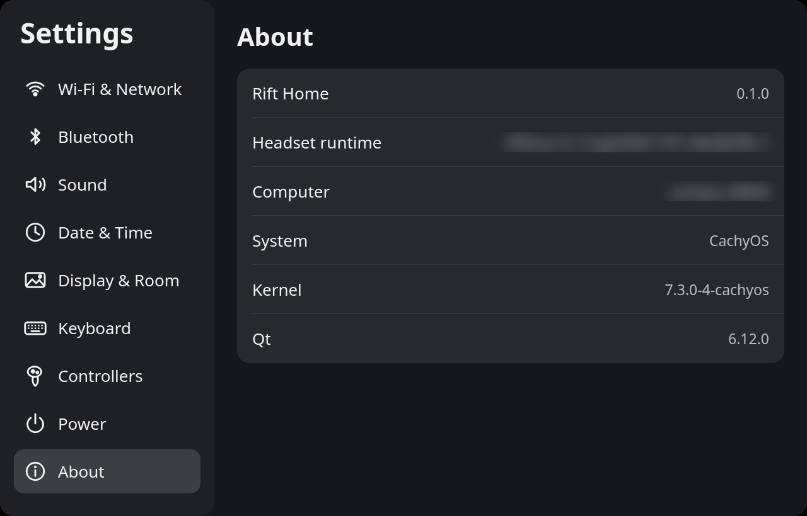

<!--
SPDX-FileCopyrightText: 2026 Aditya Mehra <aix.m@outlook.com>
SPDX-License-Identifier: CC-BY-4.0
-->

# Settings

Settings is Rift Home's own app. Open it from the dock's Settings button or from the first icon in Home. It opens as a
window in the room. A list of pages is on the left and the page you chose is on the right. Scroll with the thumbstick.

Settings that belong to Rift Home are saved in `~/.local/state/rift-home/settings.json` and apply at once, unless a
page says "from the next start". Settings that belong to the computer (Wi-Fi, Bluetooth, sound, the time) change the
computer itself, through NetworkManager, BlueZ, PipeWire and systemd. If a program a page needs is not running, the
page says so.

When a change needs an administrator's password (the time zone, automatic time), a "Password required" box opens in
the window. Type the password with the keyboard and choose "Authenticate", or "Cancel".

The pages, in order: Wi-Fi & Network, Bluetooth, Sound, Date & Time, Display & Room, Keyboard, Controllers, Power,
About.

## Wi-Fi & Network

Needs NetworkManager. If it is not running, the page says "NetworkManager is not running: networks cannot be shown."

| Option | What it does |
| --- | --- |
| Wi-Fi | Turns Wi-Fi on or off. Shown only when the computer has a Wi-Fi adapter. |
| The list of networks | Each network shows "Connected", "Saved" or nothing. Press one to see what you can do: **Join** (asks for the password of a protected network, with "Show password"), **Details**, **Disconnect**, **Forget** or **Cancel**. An open network joins without a password. |
| Wired | Each wired connection with its device and address, and "Connected" or its state. Press one for its Details. "No wired connection" shows when there is none. |
| VPN | Shown when NetworkManager knows VPNs (WireGuard ones too). A switch for each one turns it on or off. |

**Details** shows the connection's address now and lets you choose **Automatic (DHCP)** or **Manual**. Manual has
Address, the prefix length, Gateway and, with "Automatic DNS" off, DNS servers (comma separated). **Apply** asks
first: the connection restarts, and a wrong address or gateway can cut the computer off the network until you set it back.

## Bluetooth

Needs BlueZ and a Bluetooth adapter. Otherwise the page says "No Bluetooth adapter (or BlueZ is not running)."

| Option | What it does |
| --- | --- |
| Bluetooth | Turns Bluetooth on or off. |
| My devices | Paired devices, with "Connected" or "Not connected". Press one to **Connect**, **Disconnect** or **Forget** it. "No paired devices" shows when there are none. |
| Other devices | Devices found nearby. **Pair** pairs one. |
| Search for devices | **Search** looks for devices. Put the device in pairing mode first. |

## Sound

Uses PipeWire. There are two lists, **Output** and **Input**. In each, press a device to use it (a tick shows the
one in use). For the device in use:

| Option | What it does |
| --- | --- |
| Volume (Output) or Input level (Input) | A slider from 0 to 100 percent. |
| Mute | Mutes or unmutes the device. |

The dock's volume buttons change the output volume and mute too.

## Date & Time

The page shows the time and date.

| Option | What it does |
| --- | --- |
| Set automatically | Takes the time from the internet's time servers. Shows "Not synchronised yet" until it has. Needs an administrator's password to change. |
| Time zone | Press it to open a list. Type in "Search (city or region)" to narrow it, then press a zone. Needs an administrator's password. |
| 24-hour clock | Shows the time as 14:30 instead of 2:30 PM, in the dock and on this page. |

## Display & Room

### Window frames

**Dark** or **Light**: the look of the controls around windows and of Settings itself.

### Windows

| Option | What it does |
| --- | --- |
| Curve around you | A slider from flat (0 percent) to around you (100 percent). Flat puts windows side by side like a wall, all facing the same way. Around you turns each window to face you. It applies to windows you open or move from now on. |

### Room

| Option | What it does |
| --- | --- |
| Change room | Opens the room chooser: **Rift Home** (the rooms that come with it, and "None" for darkness), **Yours** (pictures in `~/Pictures/RiftHome`, with "Add your own" to open that folder) and **Desktop wallpapers**. Press a room to see it around you. **Done** closes the chooser. |
| Brightness | How bright the room is, 20 to 100 percent. |
| Turn | Turns the room, -180 to 180 degrees, for a better view of a panorama. Shown when a room is set. |

A 2:1 panorama surrounds you. HDR panoramas show in real light and carry an "HDR" badge. Any other picture, and any
desktop wallpaper, becomes a room in front of you. If the picture you chose is later deleted or moved, Rift Home shows
its default room instead (Twilight lake); "None" stays dark.

### Room during a film

How the room looks in cinema mode: **Dark** (black), **Dim** (the default) or **Soft** (stays softly lit).

### Pointer

| Option | What it does |
| --- | --- |
| Colour | The ray's colour: Ice, White, Green, Amber or Pink. |
| Thickness | Thin, Normal or Thick. |
| Hide when still | Never, After 3 s or After 10 s. A hidden pointer comes back as soon as you move the controller or press a button. |

### Sharpness

| Option | What it does |
| --- | --- |
| Apps' scale | 100 to 300 percent, in steps of 25 (200 percent is the default). Apps draw their text and buttons that big, with that many more pixels. Open apps change at once, except Chromium-based browsers, which keep their scale until you restart them. |
| Picture quality | 165 to 200 percent of the headset's pixels, averaged down to them (165 is standard). More is sharper and needs a faster graphics card. It applies from the next start. |

### Lenses

**Adjust** shows the lens test in the headset, as on the Rift's own setup: a green cross of fine lines in each eye,
with the lens spacing under it. Move the headset up and down on your face until the horizontal lines are clear, then
push in and shift the lens slider until the vertical lines are clear. Any button ends it (or it ends by itself after
two minutes). RiftLinux 0.1.5 or later draws the cross straight onto the headset's pixels, as the Rift's own software
does; with an older runtime Rift Home draws a coarser one.

### Older apps

The size of Steam and other X11 apps: **100 percent**, **150 percent** or **200 percent** (the default). It applies
from their next start, so quit Steam fully and open it again.

## Keyboard

| Option | What it does |
| --- | --- |
| Show when a text field is tapped | On (the default): the keyboard opens by itself under the window you type into. Off: open it from the dock's keyboard button (useful with a physical keyboard). |

## Controllers

A row for each thing a controller button can do, as in KDE's Shortcuts: Home, Dock, Left click, Right click, Middle
click, Keyboard, Screenshot, Recline, Follow all, Game mode, Settings, Notifications, Volume up, Volume down and Mute.
Each row shows its default and your own buttons (**None** when it has none).

- **Set a button.** Press the row's button in the Custom column. It says "Press a button, or two together". Press the
  button on a controller, or hold one and press another, then let go. The button or pair is added to the row. **Cancel**
  stops, and so does waiting 10 seconds. While it listens no controller button does anything, but the trigger still
  clicks. Rift Home does the listening, so it must be running with the headset on.
- **A button belongs to one action.** Giving it to a second action moves it, and the page says from where.
- **x** clears the row's buttons. **Reset** puts the row back to its default. **Reset all** does it for every row.

[Controllers](controllers.md) lists the defaults, which buttons can be used and how two together work.

## Power

### Apps

| Option | What it does |
| --- | --- |
| Use my own app data | On (the default): apps you start now use your own settings and profiles (Firefox's bookmarks and logins, for example). Close the app on the desktop first, because two cannot share a profile. Off: apps use Rift Home's own settings, apart from your desktop's. Running apps keep what they started with. See [Apps](apps.md). |
| Reopen my apps | On (the default): the apps you opened from Home that were still open when Rift Home ended open again when it starts. |

### Session

Each of these asks you to confirm first.

| Option | What it does |
| --- | --- |
| Leave Rift Home | Closes Rift Home and the apps in it. Window places are kept. |
| Restart | Restarts the computer. Everything running on it closes, also outside Rift Home. |
| Shut down | Turns the computer off. Everything running on it closes, also outside Rift Home. |

## About

Shows the Rift Home version, the headset runtime (the RiftLinux package version, on systems where pacman knows it),
the computer's name, the system, the kernel and the Qt version. Include these when you report a problem.
