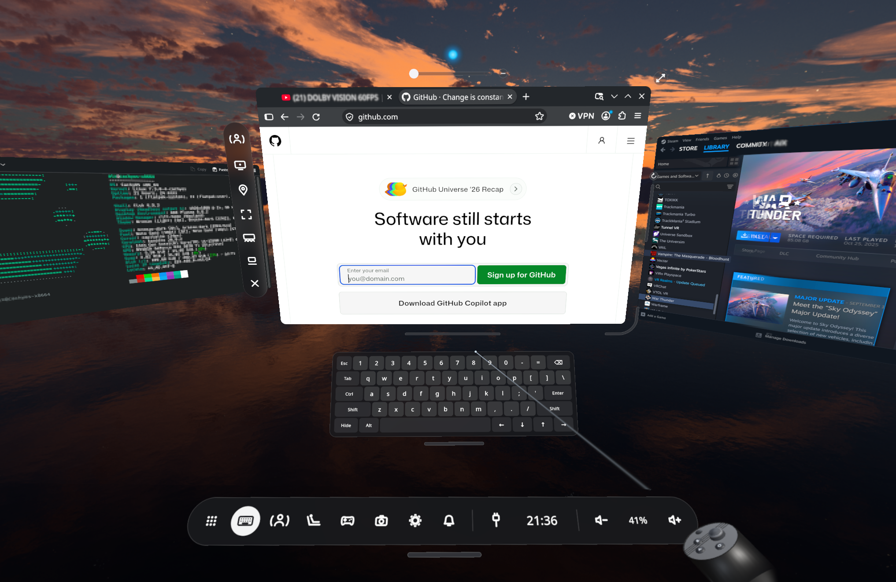

<!--
SPDX-FileCopyrightText: 2026 Aditya Mehra <aix.m@outlook.com>
SPDX-License-Identifier: CC-BY-4.0
-->

# Using Rift Home

This page covers everything you do in Rift Home: windows, Home, the dock, rooms, the keyboard, notifications,
screenshots, VR apps and games. The buttons are named as on the Touch controllers; [Controllers](controllers.md)
lists them all.

## Windows

Every app opens as a window in the room, in front of you and beside the windows already there. Windows are flat panels with rounded
corners that face you, unless you bend them.

### Point, click and scroll

- **Point.** Aim a controller at a window. A ray shows where you point. Which hand points is the one you used last.
- **Click.** Pull the trigger. Hold it to drag, for example to select text or move a slider.
- **Right click.** Press A on the right controller, or press a thumbstick.
- **Scroll.** Push the thumbstick while you point at the window. Forward scrolls up.

### The window's frame

When you point near a window's edge, its controls appear around it. Pull the trigger on a control to use it.

| Where | Control | What it does |
| --- | --- | --- |
| Left of the window | Follow | The window stays in front of you and catches up, slowly, when you turn or walk away. Press again to stop. |
| | Make main | Puts the window straight in front of you, upright, about 60 degrees wide. Windows in the way move aside. |
| | Pin | Anchors the window in the room. Press again to free it. |
| | Size | Steps through maximised, full screen and back to normal. |
| | Cinema | Shows this window alone as a large screen with the room dimmed. Press again to leave. |
| | Minimise | Hides the window. It keeps running. Home's running apps bring it back. |
| | Close | Closes the window. |
| Right of the window | Tilt bar | Tilts and turns the window. Point at the bar (or hold the trigger on it) and use the thumbstick: up and down tilt, left and right turn. It goes up to 60 degrees each way. |
| | Dot above the tilt bar | Puts the window upright and facing you again. |
| Below the window | Grab bar | Hold the trigger on it to move the window. |
| Bottom-right corner | Scale handle | Drag it to make the window larger or smaller. |
| Top-right corner | Resize button | Drag it to give the app a new size in pixels, so it shows more (or less) content instead of just getting bigger. Point at it, or drag it, to see the window's numbers above it: its pixels and shape, its colour (HDR or SDR) and depth, and how many of its pixels the headset gets. |
| Above the window | Curve slider | Drag the knob right to bend this window around you, left for flat. The thumbstick left and right bend it steadily. |
| | Dot at the right end | Makes the window flat again. |
| | Padlock at the left end | Locks the window in place: grabbing it no longer moves it, nearer or farther either, so a film is not knocked aside by a grip pressed by chance. Its size and scale still change. Press again to unlock. The lock is remembered for the app. |

### Grab, move, nearer and farther

Point at a window and hold the grip. The window follows your hand and keeps facing you. While you hold it:

- push the thumbstick forward to move it farther away, back to bring it nearer;
- push the thumbstick right to make it larger, left to make it smaller.

The window's middle stays within 45 degrees above or below your eyes, near or far, so a window never ends up straight
above you or at your feet. Let go of the grip to leave it there. You can also use the grab bar below the window with
the trigger. The controller buzzes when you grab a window and when your ray moves onto a different one.

Windows stay inside the room, with their controls and a quarter of a metre to spare. Pushed farther, a window stops
there, and it grows no larger than fits. A window farther away than that, for example one placed while the room was
off, comes nearer and smaller by as much, so it looks the same size. A window behind the room's picture would still be
drawn in front of it, and your eyes would get two different depths for it. That makes the window seem to slide as you
move your head, and it can make you feel sick. With the room off, windows go as far as 8 metres.

### The curve around you

Windows you open or move line up along an arc around you. How strongly the arc curves is a setting: **Curve around
you** under Display & Room in [Settings](settings.md). At the left end the windows form a flat wall, all facing the
same way. At the right end they form a circle around you and each one turns to face you. The setting applies to
windows you open or move afterwards. The curve slider above a window bends that one window itself.

### Follow, pin and the dock's Follow all

A following window moves with you. A pinned window stays where it is in the room, also when you recentre the headset.
The dock's **Follow all** makes every window follow, or none.

### Lying back: Recline

For watching in bed, on a sofa or lying on your side: lie down, look where you want your windows, hold a grip and
press **B** (the default; change it in [Controllers](controllers.md)). Or press X for the dock (lying back, it opens where you can see it) and choose **Recline**, the figure on
a lounger: it turns to where you looked when you opened the dock. All your windows, Home, the dock and the keyboard
turn together, over half a second, and keep their places relative to each other: the window that was in front of you is now in front of your eyes, above you
when you lie on your back. The room's picture stays where it is, so lying back you see its ceiling behind the
windows. Pointing, grabbing and moving windows work as before.

When you lie on your side, the windows turn with your head. A slight lean of the head does not tilt them. Do it
again (grip and B, or the dock's Recline) to turn everything back upright. Changed position? Twice: upright, then
reclined again to where you look now. Rift Home always starts upright.

### Full screen and cinema

The Size button steps a window to maximised and then to full screen. Full-screen windows (a game started from Steam,
for example) take the place in front of you and move the other windows aside. Cinema shows one window alone,
large, straight in front of you, with the other windows hidden and the room dimmed as you chose under "Room during a
film" in Settings. Press Cinema again to bring everything back exactly as it was.

Maximised and full-screen windows and the cinema screen are 3840x2160 pixels (4K), at any apps' scale: a 4K film
plays at its own resolution, and at the usual apps' scale of 200 percent a maximised app gets a 1920x1080 desktop drawn
twice as finely. A maximised window is as large in the room as before, with twice the detail. Rift Home shows a large
picture through a smoothly filtered smaller copy, so the extra pixels are supersampling and the picture is cleaner,
not just bigger.

A film in mpv goes into cinema in its own shape: no black bars, at the film's own pixels (a 2.39:1 film in 4K is
3840x1606). Under its screen, while you point near it, a row of shapes lets you change that. Each button shows its
shape as a small outline, its name and its ratio: Original first, then tallest to widest.

| Button | Ratio | Used for |
| --- | --- | --- |
| Original | the film's own | the film exactly as it was made |
| Classic | 4:3 | older TV and classic films |
| IMAX film | 1.43:1 | IMAX 70 mm's tall full-frame scenes |
| TV | 16:9 | TV and most series |
| Widescreen | 1.85:1 | the usual cinema widescreen |
| IMAX | 1.90:1 | digital IMAX and IMAX Enhanced |
| Streaming | 2:1 | many streaming originals |
| Scope | 2.39:1 | most big films (also called 2.35 or 2.40) |

The shape the screen has now is filled; the one your ray is on is only outlined. A shape you made yourself with the resize
button fills none. Every shape fits the same 16:9 frame around the screen, as a cinema's masking: wide shapes use its
full width, narrower ones its full height, so you can switch back and forth and always come back to the same size. The
row is there for mpv only: another app's window (a browser, Stremio, a game) does not have its video's shape, so for
those use the resize button.

The resize button at the top-right corner still gives the screen any size and shape, up to 7680x4320 pixels (8K). The
scale handle at the bottom-right corner makes the screen larger or smaller in the room without changing its pixels.

For the best picture: the screen in the film's shape at the film's own pixels (the row does that), then as large as
you like with the scale handle (a larger screen gets more of the headset's pixels), and Picture quality at 200 percent
(Settings, Display & Room). More pixels than the film has (the resize button towards 8K) make the player enlarge the
film: smoother, but no detail the film does not have.

Until Rift Home is restarted, it remembers where you put each app's cinema screen and how wide it was: the next cinema
of that app comes back there, a film in mpv in its own shape. A game from Steam (an X11 app) keeps the shape of its own
screen; use the scale handle to make it larger.

### Window places

Rift Home remembers where each app's window was, how large and how it was turned, and puts it back the next time
the app opens.

## Home and the launcher

Press Y or the left menu button to open Home. It shows:

- the apps installed on your computer, in rows of round icons, favourites first and the rest by name. Settings is
  first. Point at an icon and pull the trigger to start it. If you release the trigger somewhere else, nothing starts;
- a search field above the icons. Point at it and pull the trigger: the keyboard opens and types into it. The icons
  narrow to the names that match. Enter starts the first one;
- page dots below the icons. Push the thumbstick left or right to turn the page;
- a card for each running app under the dots. Pull the trigger on a card to bring that app in front of you (also
  when you had minimised it). The small cross on a card closes the app.

Home closes when you start an app or press the Home button again. Opening Settings from the dock also closes it.

## The dock

Press X on the left controller to show the dock. It opens below where you look and turns to face you. Press X again
to hide it. A grab bar under the dock lets you move it: hold the trigger on the bar, or the grip anywhere on the dock,
and use the thumbstick to bring it nearer or push it farther. It opens there next time.

Buttons act when you release the trigger on them. From left to right:

| Item | What it does |
| --- | --- |
| Home | Opens or closes Home. |
| Keyboard | Shows or hides the virtual keyboard. |
| Follow all | Every window follows you, or none. |
| Recline | Turns everything to where you look, for lying back; again: upright (see [Lying back](#lying-back-recline)). |
| Game controller | Starts or stops game mode. |
| Camera | Takes a screenshot of your view. The dock hides first so it is not in the picture. |
| Settings | Opens Settings, or closes it if it is open. |
| Bell | Shows the list of notifications above the dock, with their number on the bell. |
| Network | Shows the connection (Wi-Fi strength, wired or none). Press it to open the network page in Settings. |
| Time | Shows the time. It is not a button. |
| Volume down, volume, volume up | The middle one shows the volume. Press it to mute or unmute. |

## Rooms

The room is the scene around you. Open **Settings, Display & Room, Change room** to choose one. There are three
groups: Rift Home's own rooms, your own pictures and your desktop's wallpapers. A room shows around you as soon as you
choose it. "None" leaves you in darkness.

Rift Home comes with three HDR panoramas that surround you in real light: **Twilight lake** (the room you start
in), **Mountain sunset** and **Night sky**. They are in `/usr/share/rift-home/rooms`.

**Your own rooms.** Put pictures in `~/Pictures/RiftHome`. They show in the "Yours" group at once, and "Add your own"
opens that folder. Two kinds work:

- a **2:1 panorama** (a full 360-degree picture, twice as wide as it is high) surrounds you;
- **any other picture** becomes a room in front of you, with its colours all around.

Brightness and a Turn slider (to turn a panorama for a better view) are on the same page.

## The keyboard

Rift Home has a virtual keyboard with a US layout, drawn in the room. You type by pointing at keys and pulling the
trigger. Shift, Ctrl and Alt work for one key: tap Shift, then the letter. Tap Shift twice for caps lock and a third time
to turn it off. The Hide key closes it.

- It opens by itself under the window when you click a text field (switch this off under Keyboard in Settings).
- The dock's Keyboard button, or a controller button set to Keyboard, opens and closes it by hand.
- Move it like the dock: the trigger on its grab bar, or the grip anywhere on it, and the thumbstick for nearer and
  farther. It opens where you left it.
- A physical keyboard works too and types into the focused window.

## Notifications

Apps that send desktop notifications show them in the room. The newest one appears as a card in front of you for a few
seconds. Pull the trigger on a card to run its main action (for example "Open"). Some have buttons of their own.
All notifications stay in the dock's bell list until you close them. Each has a close button and the list has
"Clear all".

## Screenshots

Use the dock's Camera button, or give a controller button the Screenshot action (see [Controllers](controllers.md)).
The camera saves one picture of your view as a PNG in `~/Pictures/RiftHome/screenshots`, named by the date and
time (for example `20261108-141503.png`); the dock hides first, and a message in the room says when it is saved. Where
RiftLinux's runtime takes screenshots, the picture is its own: exactly what the headset shows, the controllers
included. With an older runtime Rift Home draws it from the same windows and room, 2560 x 1600 pixels, without the
controllers.

## VR apps and switching between them

VR apps that use RiftLinux's OpenXR runtime show up in Home's running apps next to your windows. Pull the trigger on
a VR app's card to bring it in front of you: the runtime shows that app, and Rift Home waits. To come back to Rift Home,
use "Switch application" in the Rift panel (the headset's own menu, from the right Oculus button), or end the VR
app. VR cards have no close button, because the app is not Rift Home's to close.

VR apps you start from Rift Home use RiftLinux's runtime, also inside Steam's container, so Steam VR games started
from Rift Home need no setup. SteamVR is different: if you start it while Rift Home is running as the login session, Rift
Home steps aside and gives it the headset, and takes the headset back when SteamVR ends.

## Games and game mode

Steam and other X11 apps open as windows like any other (see [Apps](apps.md)). A game that goes full screen takes the
place in front of you.

For a game that expects a gamepad, use **game mode**. Press the dock's game controller button. Your controllers
become an Xbox-style gamepad for the game, and the rays stop. To leave, hold the left menu button for one second.
The button map is in [Controllers](controllers.md).

## Leaving

Open Settings, then Power, then "Leave". Rift Home asks, then closes its apps and ends. From the login-screen session
you go back to the login screen. From the desktop's menu you go back to the desktop. Window places are kept.
